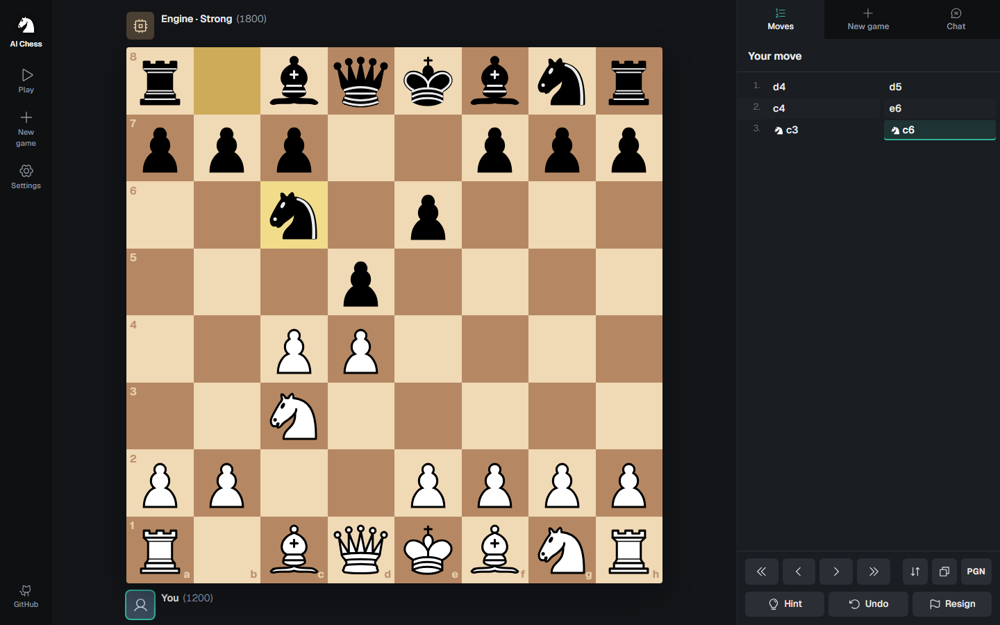
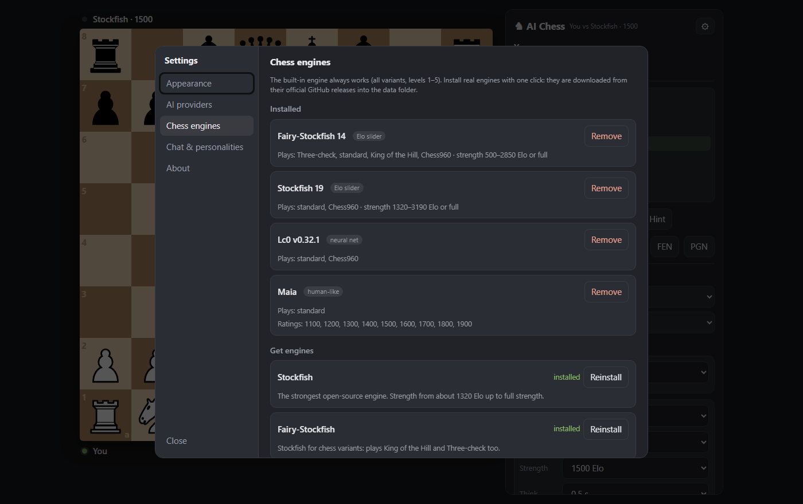
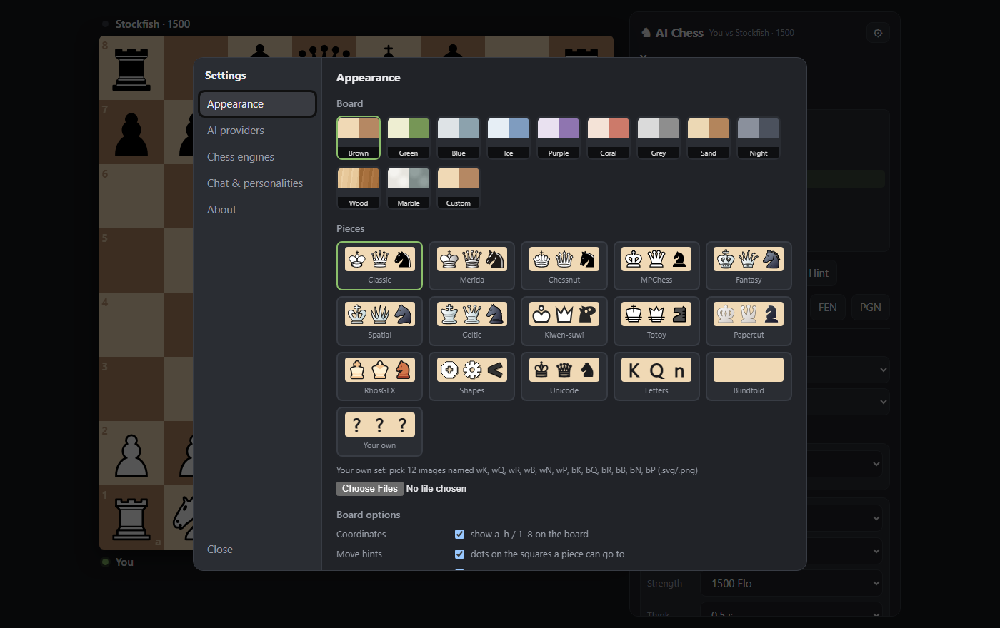

# AI Chess

**Play chess against your local AI models.** Point it at LM Studio, Ollama, llama.cpp or any other local server, pick a model, and play. Or let the model play Stockfish, another model, or itself, and watch what happens when an LLM tries to keep track of a chess board.

Everything runs on your own machine. One file to download, nothing to install.



## Start in a minute

**Windows:** download `ai-chess-windows.exe` from the [Releases page](https://github.com/BrandScape-Media/ai-chess/releases) and double-click it. The game opens in its own window and closes itself when you close the window. (The program isn't code-signed, so Windows may say "Windows protected your PC": click *More info* → *Run anyway*.)

**Any system with Python 3.10+:** no packages needed.

```bash
git clone https://github.com/BrandScape-Media/ai-chess
cd ai-chess
python server.py
```

On Windows you can also double-click `AI Chess.bat`; on Linux/macOS run `./run.sh`. The board opens at http://localhost:8800.

## Pick your opponent

Each side (White and Black) can be **Human**, a **Chess engine** or a **Local AI model**, so any matchup works: you vs a model, a model vs Stockfish, two models against each other, or one model against itself.

### Local AI models: choose a backend

Start your app, load a model, then in the game choose *Local AI model* and the provider. The model list fills in automatically (loaded models are marked ●).

| App | Default address | Notes |
|---|---|---|
| [LM Studio](https://lmstudio.ai) | `http://127.0.0.1:1234/v1` | Developer tab → start the server |
| [Ollama](https://ollama.com) | `http://127.0.0.1:11434/v1` | runs in the background after install |
| [llama.cpp](https://github.com/ggml-org/llama.cpp) `llama-server` / llama-swap | `http://127.0.0.1:8080/v1` | `llama-server -m model.gguf --port 8080` |
| [Jan](https://jan.ai) | `http://127.0.0.1:1337/v1` | enable the local API server |
| [KoboldCpp](https://github.com/LostRuins/koboldcpp) | `http://127.0.0.1:5001/v1` | |
| [text-generation-webui](https://github.com/oobabooga/text-generation-webui) | `http://127.0.0.1:5000/v1` | start with `--api` |
| [vLLM](https://github.com/vllm-project/vllm) | `http://127.0.0.1:8000/v1` | `vllm serve <model>` |
| [GPT4All](https://gpt4all.io) | `http://127.0.0.1:4891/v1` | enable the API server in settings |

Running a model on another PC? Change the address in **⚙ Settings → AI providers**, or add a **Custom provider** (any OpenAI-compatible URL, or the Anthropic API).

**Cloud models work too:** OpenAI, Anthropic (Claude), Google Gemini, OpenRouter, Groq, Mistral, DeepSeek, xAI and Together. Paste your API key in Settings → AI providers. Keys are stored only on your computer (`data/settings.json`) and sent only to that provider.

### How the model sees the game

* **Sees:** a fresh prompt with the full board every turn (strongest play), one long chat with the board each turn, or **one chat with moves only**, the classic "LLM loses track of the board" setup.
* **Picture:** vision models also get an image of the board. Text-only models are detected and get text only.
* **Thinking:** off / low / medium / max for reasoning models.
* **Hints:** optionally list the legal moves in the prompt.

### Chess engines

The built-in engine always works (5 levels, every variant). Real engines install with one click from **⚙ Settings → Chess engines**, downloaded from their official GitHub releases:

| Engine | |
|---|---|
| **Stockfish** | the strongest open-source engine, strength from ~1320 Elo to full |
| **Fairy-Stockfish** | Stockfish for variants (King of the Hill, Three-check) |
| **Leela Chess Zero** | neural-network engine in the AlphaZero style |
| **Maia 1100–1900** | Leela nets trained on human games: plays like a real person of that rating |
| **Berserk**, **Koivisto**, **Obsidian**, **Caissa**, **Clover**, **Halogen** | more top engines, each with its own style |
| **Arasan** | a veteran: first released in 1994 and still developed; can play at a set Elo |
| **Weiss**, **FabChess**, **Seer**, **Velvet**, **Altair** | lesser-known hobby engines, some without a neural network |

Two historical opponents are built in, no download needed: **Turochamp**, the paper program Alan Turing and David Champernowne wrote in 1948 (recreated from their rules), and a **Random mover**.

Any other UCI engine (Komodo, Ethereal, …) can be added with **Add engine → Browse…**. AlphaZero and Deep Blue were never released; Leela is AlphaZero's open-source counterpart, and Stockfish at about 2850 Elo plays at Deep Blue's level.

You can change an engine's strength in the middle of a game: click its level next to its name for sliders (Elo, search depth, rating, …).



## Chaos mode

LLMs are famous for illegal chess moves: knights that move like bishops, pieces that come back from the dead, a queen out of nowhere. Turn on **Allow illegal moves** and choose which sides may break the rules. Their slips are simply played, and nobody tells the model. An illegal move teleports the piece, captures your own pieces, revives a piece the model forgot was taken, or spawns a new one. A captured king ends the game. With chaos off, illegal moves are bounced back to the model with feedback.

## Chat with your opponent

Like the chat on chess.com: talk to the model while you play. Every computer opponent gets a hidden **personality** (trash talker, nervous beginner, pirate captain, zen master, noir detective, …). They chat like real players: a hello at the start, a reaction at the big moments, "gg" at the end, and they may ignore you if that fits their character. Engines banter with canned lines and an ELIZA-style chat bot that knows the position. Personalities can be added, edited, removed or pinned to a model in **Settings → Chat & personalities**.

## Also

* **Variants:** Chess960 (Fischer Random), King of the Hill, Three-check, Transcendental chess, any position from a FEN. The rules are explained to the models in their prompt.
* **Arrows and circles** like on chess.com (right-click drag; Shift/Alt/Ctrl for colors), plus a sneaky option: **let the opponent peek at your arrows**. Plan honestly, or bait it.
* **Clocks:** bullet (1, 1|1, 2|1), blitz (3, 3|2, 5), rapid (10, 10|5, 15|10) or 30 minutes. Everybody plays on the clock: engines manage their time like in a real game, and AI models can lose on time (or play untimed if you prefer).
* **Premoves:** queue one or several moves while the opponent thinks. In chaos mode they are played even when they've become illegal.
* **Game history** with the winner of every game, replay and PGN.
* **Ratings:** engines show realistic Elo estimates, every AI model gets a random rating for the game, and your own rating goes up and down as you win and lose.
* **Hints** (best move from Stockfish or the built-in engine) and **takebacks**, each can be switched off.
* Move list with review, flip board, PGN/FEN export, the game is saved automatically.
* **12 piece sets** and **11 board themes**, custom colors, or upload your own pieces.



## Command line

```
python server.py [--port 8800] [--lan] [--no-browser] [--app | --tab] [--exit-when-idle SEC] [--data DIR]
```

`--lan` lets other devices on your network play (they can use your AI providers too). `--app` opens a chromeless Edge/Chrome window (default for the .exe).

## Building the .exe yourself

`build_exe.bat` builds `dist\ai-chess.exe` with PyInstaller in a private virtual environment. Pushing a tag like `v1.0.0` builds Windows, Linux and macOS binaries on GitHub Actions and attaches them to a release.

## Tests

```bash
node tests/core.test.js
```

Move generation is checked with perft against the standard test positions (including Chess960), plus variants, unchecked moves and the engine.

## Privacy and security

The server listens on `localhost` only (unless `--lan`), only accepts requests from its own page, and is not an open proxy. Settings, API keys, the current game and downloaded engines live in the `data/` folder next to the program.

## License

GPL-3.0-or-later. Piece artwork from the [lichess](https://github.com/lichess-org/lila) project; see [web/pieces/LICENSES.md](web/pieces/LICENSES.md). Chess engines are separate programs with their own licenses and are downloaded only when you click Install.
